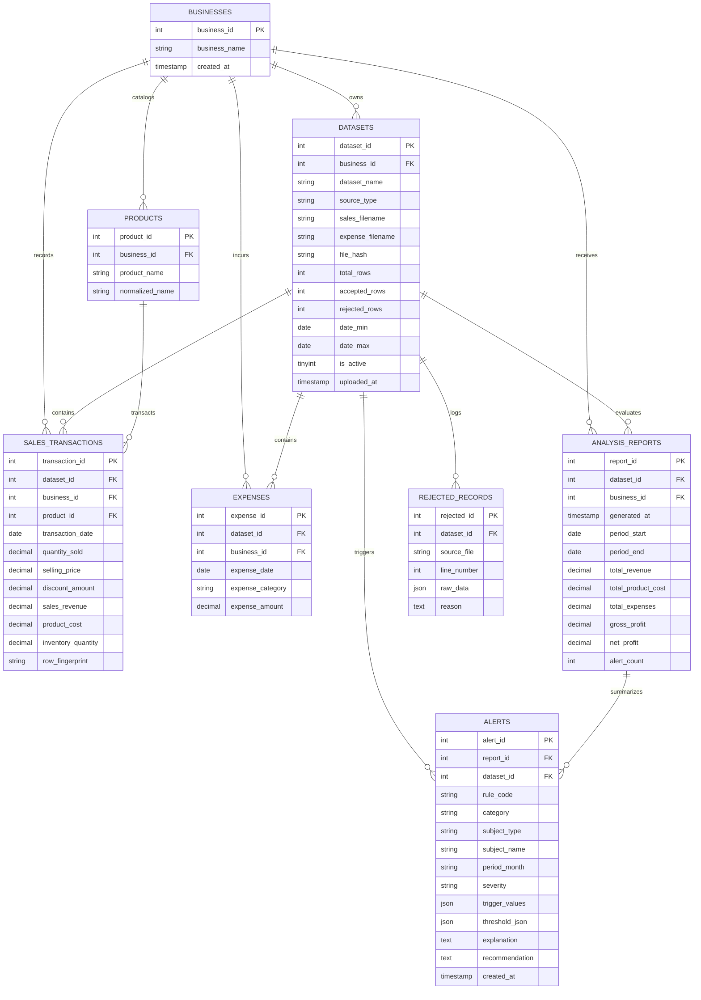

# Entity-Relationship Diagram (ER_DIAGRAM.md)

The following Mermaid diagram visualizes the relational schema of the Business Loss Detection and Decision Support System, showing foreign keys, cardinality, and cascade deletion paths.

